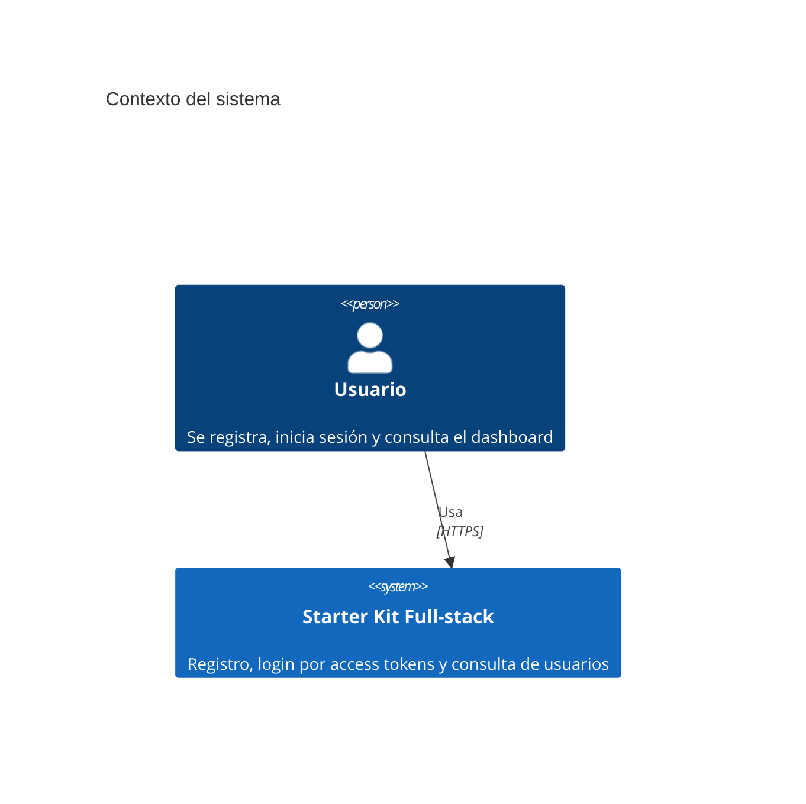
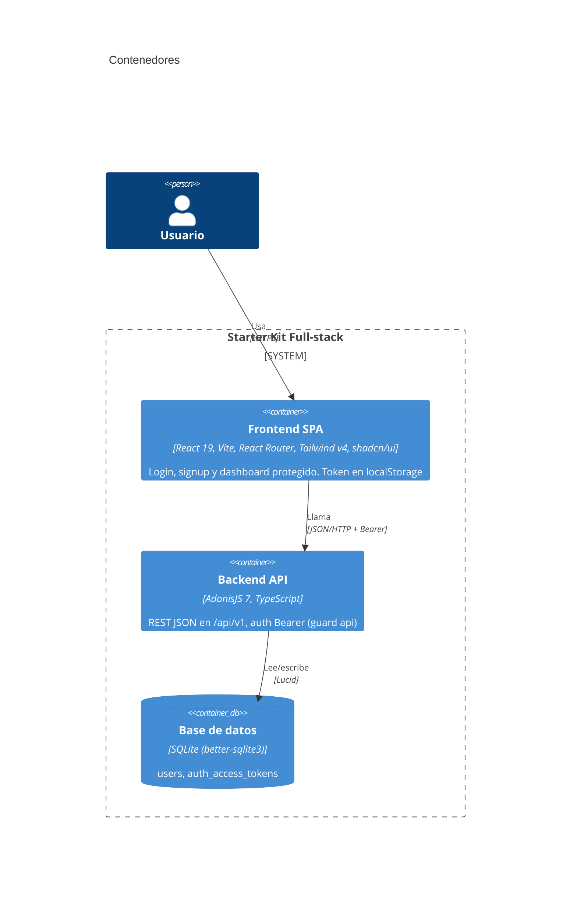
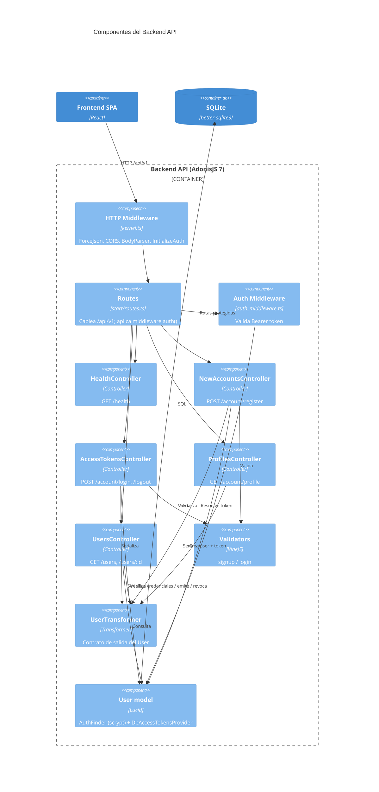
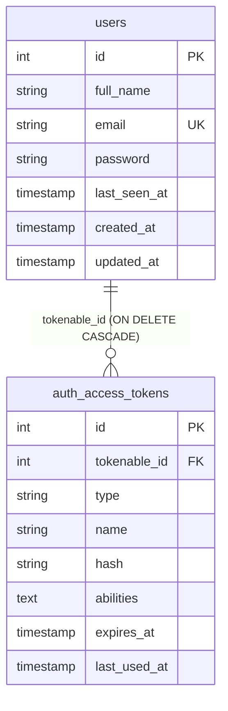
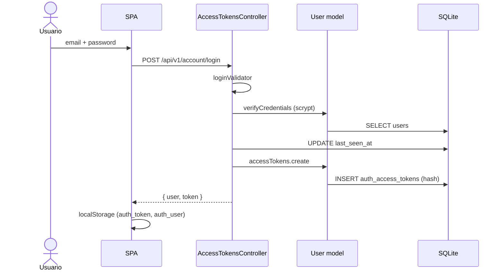

# Arquitectura C4

Documentación del modelo C4 del starter kit. Fuente de verdad: [`workspace.dsl`](workspace.dsl) (Structurizr DSL). Este documento replica los diagramas en Mermaid para verlos directamente en GitHub.

Renderizar el DSL con Structurizr Lite:

```bash
docker run -it --rm -p 8080:8080 -v "$PWD/docs/architecture:/usr/local/structurizr" structurizr/lite
```

## Nivel 1 — Contexto



No hay sistemas externos: ni email, ni OAuth, ni servicios de terceros.

## Nivel 2 — Contenedores



| Contenedor | Tecnología | Puerto | Config |
|---|---|---|---|
| Frontend SPA | React 19 + Vite | 5173 | `VITE_API_URL` (por defecto `http://localhost:3333/api/v1`) |
| Backend API | AdonisJS 7 | 3333 | `backend/.env` (`PORT`, `HOST`, `APP_KEY`) |
| Base de datos | SQLite | fichero | `backend/tmp/db.sqlite3` (no se commitea) |

Decisión relacionada: [ADR SQLite en lugar de PostgreSQL](../adr/20261108-uso-de-sqlite-en-lugar-de-postgresql.md), [ADR VineJS en lugar de Zod](../adr/20261108-uso-de-vinejs-en-lugar-de-zod.md).

## Nivel 3 — Componentes del Backend API



### Endpoints

| Método | Ruta (`/api/v1`) | Auth | Controller |
|---|---|---|---|
| GET | `/health` | No | HealthController#index |
| POST | `/account/register` | No | NewAccountsController#store |
| POST | `/account/login` | No | AccessTokensController#store |
| POST | `/account/logout` | Bearer | AccessTokensController#destroy |
| GET | `/account/profile` | Bearer | ProfilesController#show |
| GET | `/users` | Bearer | UsersController#index |
| GET | `/users/:id` | Bearer | UsersController#show |

## Nivel 3 — Componentes del Frontend (resumen)

| Componente | Archivo | Responsabilidad |
|---|---|---|
| `App` | `src/App.tsx` | Rutas: `/`→`/dashboard`, `/login`, `/signup`, `/dashboard` |
| `ProtectedRoute` | `src/components/ProtectedRoute.tsx` | Redirige a `/login` si no hay token |
| `LoginPage`, `SignupPage`, `DashboardPage` | `src/pages/` | Páginas |
| `LoginForm`, `SignupForm` | `src/components/` | Formularios |
| `authService` | `src/services/authService.ts` | `fetch` a la API, persistencia de token/usuario en `localStorage` |
| `ui/*` | `src/components/ui/` | Primitivas shadcn/ui |

## Modelo de datos



## Flujo clave: login



## Observaciones de arquitectura

- Token con caducidad de 30 días, almacenado hasheado en BD; el SPA lo guarda en `localStorage` (expuesto a XSS).
- CORS abierto (`origin: true`, `credentials: true`): conviene restringirlo fuera de desarrollo.
- `ProtectedRoute` solo comprueba la existencia del token en cliente; la validez real la decide el backend (401).
- `AuthMiddleware.redirectTo = '/login'` no aplica a una API JSON; el cliente recibe 401.
- Pendiente según el código: `GET /users/active` (Sesión 3).
